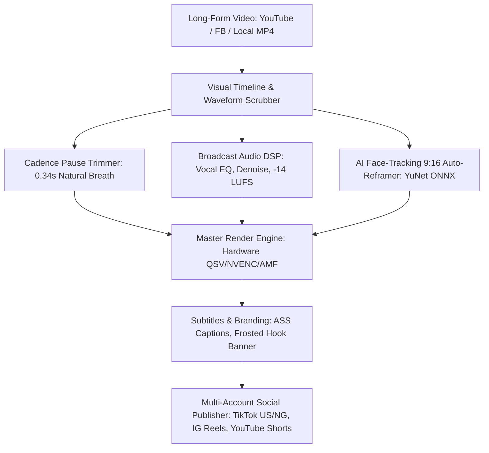

# hclipper 🎬
### Free, Local-First Desktop Video Clipper, Auto-Reframer & Social Publisher

[](https://opensource.org/licenses/MIT)
[](https://github.com/ea-manni/hclipper)
[](https://github.com/ea-manni)
[](https://github.com/ea-manni)
[](https://github.com/ea-manni/hclipper)

> 🏢 **hclipper is an open-source product of Daysman Solutions Limited.**  
> 💼 **Looking to hire / contract?** Built by [@ea-manni](https://github.com/ea-manni). Available for custom AI video processing pipelines, Electron desktop development, and full-stack engineering contracts.

**hclipper** is a 100% free, open-source desktop application that empowers content creators, church media teams, podcasters, and educators to transform long-form video (YouTube, Facebook, local MP4/MOV) into viral vertical (9:16) shorts with automated AI face-tracking, cadence-aware silence trimming, broadcast audio mastering, animated captions, and multi-platform publishing (**TikTok**, **Instagram Reels**, **YouTube Shorts**).

---

## 🌟 Why hclipper?

Most creators, ministries, and podcasters face two bad choices:
1. **Expensive SaaS Subscriptions** (Opus Clip, Vidyo.ai, Descript) charging $29–$89/month with restrictive processing minutes, watermarks, and cloud privacy risks.
2. **Complex NLE Suites** (Premiere Pro, DaVinci Resolve) requiring steep learning curves, hours of manual keyframing, and repetitive editing.

**hclipper** bridges the gap: a zero-cost, local-first desktop application with a clean, friendly graphical interface. Everything runs on your own machine—no cloud bills, no privacy leaks, no monthly caps.



---

## ✨ Key Features

- 📥 **Multi-Platform Ingestion**: Paste a YouTube or Facebook Live link for high-speed download, or drag-and-drop local MP4, MOV, MKV, WebM, and AVI files.
- ✂️ **Visual Waveform Trimming**: Scrub through long sermons or podcasts, preview 800-point audio waveforms with Wavesurfer.js, and cut precise highlight moments down to the millisecond.
- 🔇 **Cadence-Aware Silence Trimming**: Eliminate awkward dead air while preserving the natural 0.34s breathing rhythm of authentic speech.
- 🎙️ **Studio Audio & Video Mastering**: Vocal enhancement (80Hz highpass), room noise suppression (`afftdn`), dynamic compression, background music ducking, and broadcast loudness normalization (-14 LUFS).
- 🎯 **AI 9:16 Smart Auto-Reframing**: Lightweight on-device face tracking (OpenCV YuNet ONNX) running at 60+ FPS keeps speakers centered when converting 16:9 landscape to 9:16 vertical.
- 💬 **Dynamic Kinetic Subtitles**: Word-level animated captions (TikTok style, Segoe UI Black, gold gradients) with high contrast placed in the TikTok/Instagram safe visual zone (`MarginV=740`).
- 🎨 **Branding & Social Pills**: Customizable top hook banners (frosted glass), animated handle pills (TikTok, IG, YT), ambient worship/music beds, and branded outro screens.
- 🚀 **Multi-Account Social Publisher**: One-click direct publishing to YouTube Shorts, TikTok (including international and proxy-guarded US accounts), and Instagram Reels with persistent browser sessions.
- 💻 **Standalone Windows Installer (.exe)**: Bundled with embedded FFmpeg 9.0.1, standalone yt-dlp, and local AI models—zero technical prerequisites required.

---

## 🚀 Quick Start

### Option 1: Standalone Windows Installer (Recommended for Creators)
1. Download `hclipper Studio Setup 1.0.0.exe` from the [Releases](https://github.com/ea-manni/hclipper/releases) page.
2. Run the installer and launch **hclipper Studio** from your Desktop or Start Menu.
3. Paste a YouTube URL or drop your video file to start clipping!

### Option 2: Running from Source (Developers & Contributors)

#### Prerequisites
- Node.js (v18+)
- Python (v3.10+)
- Git

```bash
# 1. Clone the repository
git clone https://github.com/ea-manni/hclipper.git
cd hclipper

# 2. Install Python Dependencies
pip install -r requirements.txt

# 3. Setup and Run Electron Studio UI
cd ui
npm install
npm run electron:dev
```

---

## ⚡ CLI Pipeline Usage

The underlying engine can also be operated headlessly via command-line interface:

```bash
# Ingest long-form video stream
python -m engine.cli ingest --url "https://youtube.com/watch?v=..." --output downloads/stream.mp4

# Generate audio waveform and detect cadence pauses
python -m engine.cli trim --input downloads/stream.mp4 --waveform --silence

# Analyze face trajectory for 9:16 vertical reframing
python -m engine.cli reframe --input downloads/stream.mp4 --analyze

# Render final vertical short with audio DSP and captions
python -m engine.cli render --input downloads/stream.mp4 --start 120.5 --end 185.0 --output clips/Clip1_Master.mp4 --dsp --subtitles

# Check social account login status
python -m engine.cli session-status --json

# Publish batch range of clips to Instagram, TikTok NG, and YouTube
python -m engine.cli publish --publish 1-6 --platforms ig,tt_ng,yt
```

---

## 🛠️ Technology Architecture

| Component | Technology | Purpose |
| :--- | :--- | :--- |
| **Desktop Shell** | Electron 44 | Cross-platform desktop window & native OS integration |
| **Frontend UI** | React 19 + TypeScript + Tailwind CSS | Modern studio GUI with timeline scrubber & live preview |
| **Waveform Engine** | Wavesurfer.js | Real-time audio waveform visualizer and range selector |
| **Media Processing** | FFmpeg 9.0.1 (QSV / NVENC / AMF) | Trimming, audio DSP, video filtering, complex composition |
| **Stream Downloader**| yt-dlp | High-speed ingestion from YouTube, Facebook, and 1000+ sites |
| **Face Tracking** | OpenCV + YuNet ONNX | Smooth speaker tracking for 9:16 vertical crop |
| **Captions AI** | faster-whisper / WebVTT / ASS | High-accuracy word-level subtitles without cloud API keys |
| **Social Automation**| Playwright Persistent Sessions | Direct publishing with account & proxy isolation |
| **Distribution** | electron-builder | Standalone Windows NSIS installer (`.exe`) |

---

## 📖 Documentation & Community

- [Architecture Blueprint](ARCHITECTURE.md) - Deep dive into system design, DSP filters, and process flows.
- [Implementation Roadmap](IMPLEMENTATION_PLAN.md) - Phased roadmap from foundation to open-source v1.0.0 release.
- [Contributing Guidelines](CONTRIBUTING.md) - How to contribute code, report bugs, or submit templates.
- [Community Outreach Playbook](COMMUNITY_OUTREACH.md) - Pitches and templates for church networks and podcasters.
- [Code of Conduct](CODE_OF_CONDUCT.md) - Community participation standards.

## 🏢 Author & Company Attribution

**hclipper** is an open-source product created and actively maintained by **Daysman Solutions Limited**.

- **Company**: Daysman Solutions Limited
- **Creator & Lead Maintainer**: [@ea-manni](https://github.com/ea-manni)
- **GitHub Repository**: [https://github.com/ea-manni/hclipper](https://github.com/ea-manni/hclipper)
- **Work / Hiring Inquiries**: Looking for a senior software engineer or contract team to build production desktop applications, automated video/audio AI pipelines, or scalable web platforms? Reach out through GitHub: [@ea-manni](https://github.com/ea-manni).

---

## ⚖️ License

Distributed under the **MIT License**. Copyright (c) 2026 Daysman Solutions Limited.

Free for personal, commercial, and ministry use with standard MIT attribution. See [LICENSE](LICENSE) for details.